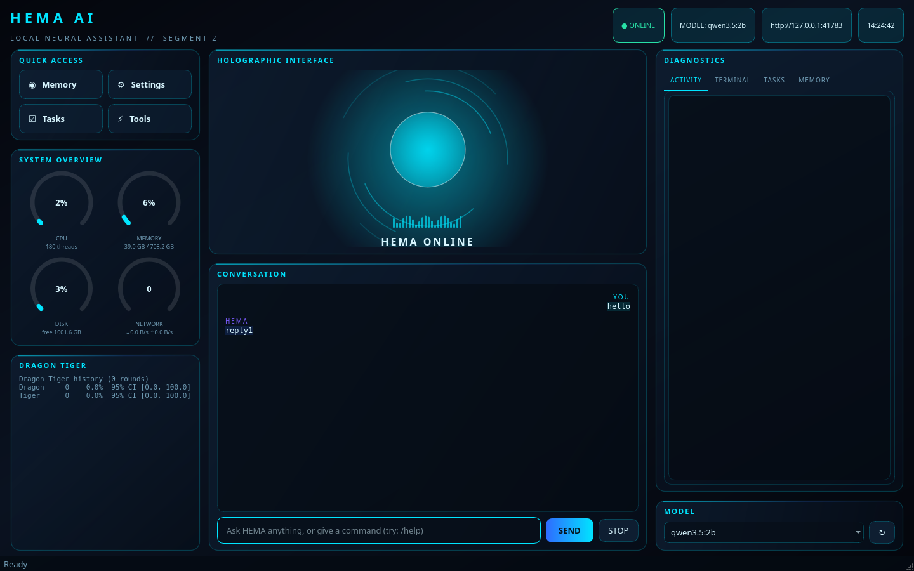

# HEMA - Local Personal AI Assistant

A modular, locally-run assistant. No paid APIs. Only the Python standard library is
required for the core; GUI, voice and charts are optional extras.

## Quick start (Windows PowerShell)
```
cd path\to\hema
python -m venv .venv
.venv\Scripts\activate            # optional but recommended
pip install -r requirements.txt   # core needs nothing extra
copy .env.example .env            # optional: edit model / host
ollama serve                      # in another window, if not already running
python main.py --doctor           # check environment + Ollama, writes logs/doctor.txt
python main.py                    # text console
python main.py --gui              # desktop interface (needs: pip install PySide6)
```

## Desktop interface (Segment 2, milestone 1)
```
pip install "PySide6>=6.5,<6.12"
python main.py --gui
```


Dark cyberpunk layout: holographic HEMA avatar, glass panels, cyan/blue neon, smooth animations.

- **Chat panel** - streams from the real HEMA engine (no canned answers). Requests run on a
  background QThread, so the window never freezes; STOP interrupts a reply.
- **System overview** - live CPU, memory, disk and network arcs, refreshed every 1.5 s
  (stdlib only: ctypes on Windows, /proc on Linux; uses psutil if you happen to have it).
- **Quick access** - Memory, Settings, Tasks, Tools.
- **Diagnostics** - ACTIVITY (audit log), TERMINAL (live tail of `logs/hema.log`), TASKS
  (progress + completion report), MEMORY.
- **Settings** - shows the active model and the Ollama URL, lists installed models and
  switches the model for the session (`docs/hema-settings.png`).
- **Connection pill** - ONLINE/OFFLINE plus the exact error, e.g.
  "Cannot reach Ollama at http://127.0.0.1:11434: Connection refused".
- **Approval banner** - engine actions that need permission (run a command, delete a memory)
  appear in the window with Allow / Deny; unanswered requests time out to deny.

The UI prefers `qwen3.5:2b` (`HEMA_UI_MODEL`); the console keeps `HEMA_MODEL`.

## Troubleshooting
Run `python main.py --doctor`. It reports Python, whether port 11434 is open, the Ollama
version, installed models, whether your preferred model exists, folder permissions, disk
space and optional packages. Exit code is 0 only when all critical checks pass.

If "Ollama port" fails on your PC:
```
ollama serve            # then open http://127.0.0.1:11434 in a browser
ollama list             # shows installed models
curl http://127.0.0.1:11434/api/tags
```

## Tests
```
python -m unittest discover -s . -t . -p "test_*.py" -v
```
89 tests (7 GUI tests are skipped when PySide6 is absent). They use a fake local Ollama server, so they run without Ollama.

## What works (verified)
| Area | Module | Verified by |
|---|---|---|
| Ollama text chat, streaming, model discovery | `ai/`, `core/assistant.py` | unit + integration tests |
| Conversation context, error handling | `core/conversation.py` | unit tests |
| SQLite memory (search/edit/delete, secret refusal) | `memory/` | unit tests |
| Permissions, approvals, audit log, workspace guard | `security/` | unit tests |
| Task planning, execution, retries, recovery | `core/task_manager.py`, `planner.py`, `executor.py` | unit tests |
| Files, commands, apps, processes, Windows startup | `automation/` | unit tests |
| Code inspection/editing/fixing | `coding/` | unit tests |
| Unity/Unreal/MCP project work | `game_development/` | unit tests (file level) |
| Self-update with backup + rollback | `core/self_update.py` | unit tests |
| Dragon Tiger statistics | `analytics/` | unit tests |
| Voice wake word + controller | `voice/` | unit tests (no real mic/TTS here) |
| End-to-end command routing | `core/hema.py`, `main.py` | integration + CLI run |

## GUI verification (headless Qt, in the build sandbox)
- 7 GUI tests pass: window builds with all panels; a real chat round-trip through the engine
  (asserts the request reached the model API and the streamed reply is displayed); offline
  error state; memory command via the UI; approval banner deny path; streaming; screenshot.
- `python main.py --gui` runs and stays up.
- The screenshots in `docs/` are rendered from the real window.

## NOT verified yet (needs your PC)
- Real Ollama and your models (`qwen3-coder-local:latest`, `qwen3.5:2b`) - the GUI
  demonstrations used a local fake Ollama server, because Ollama is unreachable
  from the build sandbox
- The PySide6 window (not installable in the sandbox)
- Real microphone, wake word and speech output
- Live Unity Editor and Unreal Editor actions (only file-level operations are tested)
- Real MCP servers (the probe works against a fake MCP server)

## Commands HEMA understands
```
/help /models /model <name> /reset /tasks /status /dt /quit
plan: <request>            show tasks            remember: <fact>
recall <text>              forget <id>            inspect: <path>
open <app>                 run: <command>         list processes
dragon|tiger|tie result    dragon tiger stats     run with windows
update yourself
```

## Safety
- All file access is restricted to `workspace/` (env `HEMA_WORKSPACE`).
- Overwrites, deletes, commands, app launches, microphone use and self-updates need approval.
- Destructive commands (format, net user, firewall/Defender changes, sudo/runas) are blocked outright.
- Every approval and denial is written to `logs/audit.log`.
- Passwords/API keys are refused by memory and file writes, and redacted from command output.

## Layout
```
core/ ai/ voice/ memory/ automation/ coding/ game_development/ analytics/ interface/ security/
tests/ data/ logs/ backups/ workspace/ main.py config.py requirements.txt .env.example
```

## Notes
- Unity Editor / Unreal Editor actions that need the running editor (creating GameObjects,
  Blueprints, verifying in-editor results) are NOT implemented through MCP yet: no MCP server
  is connected. `game_development/mcp_integration.py` detects configs and really handshakes a
  server when one is configured.
- Self-update applies code changes only when you pass explicit changes and approve them; it
  backs up first and rolls back if compile checks or tests fail.
